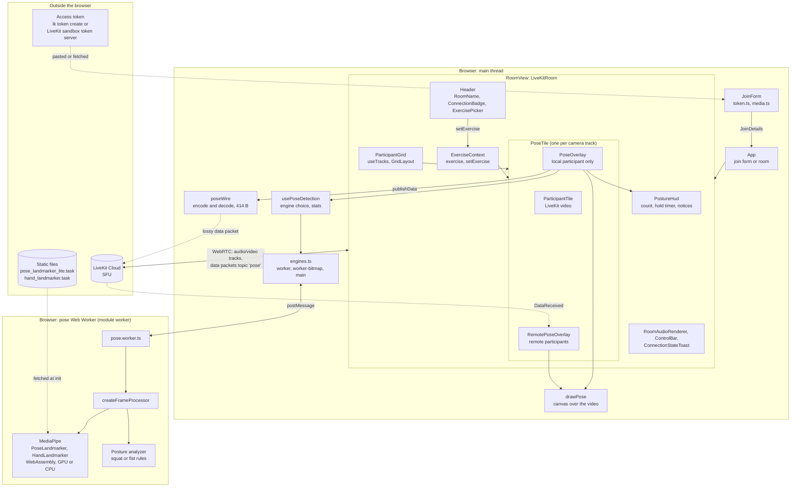
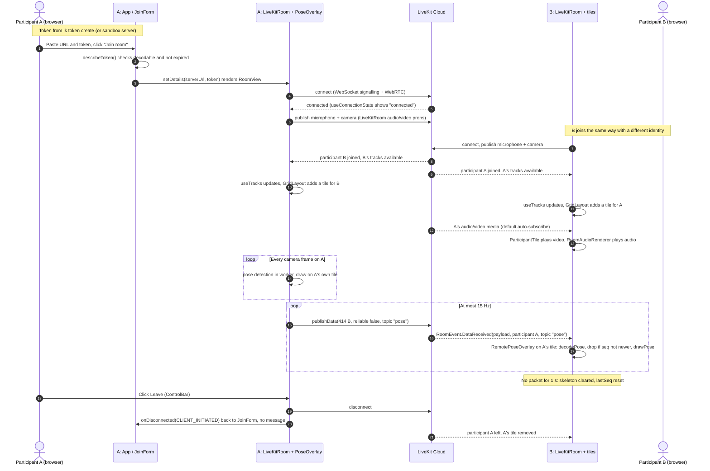
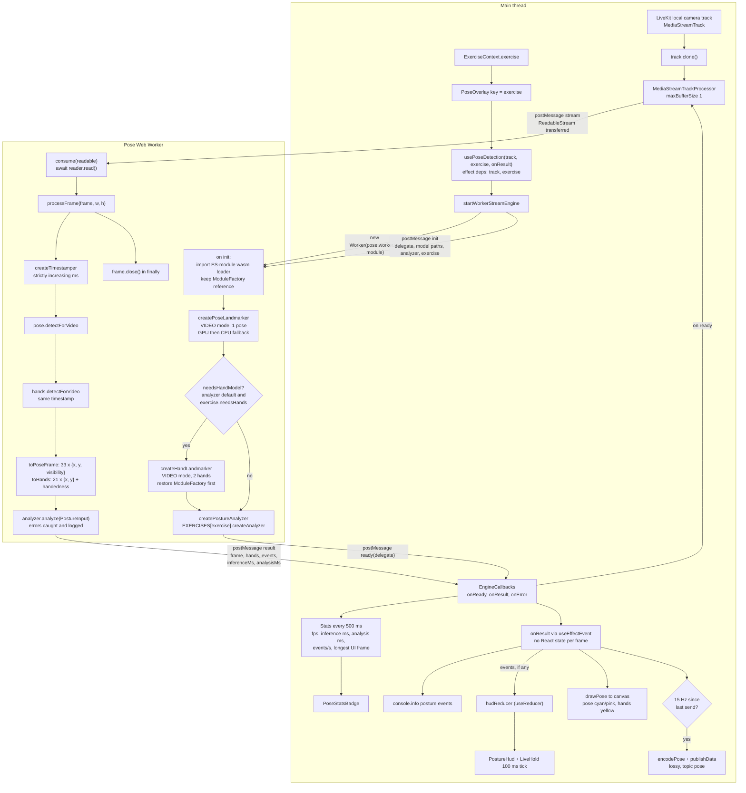
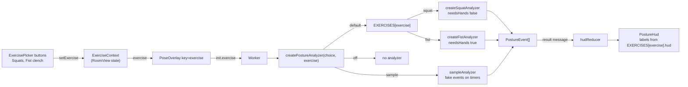
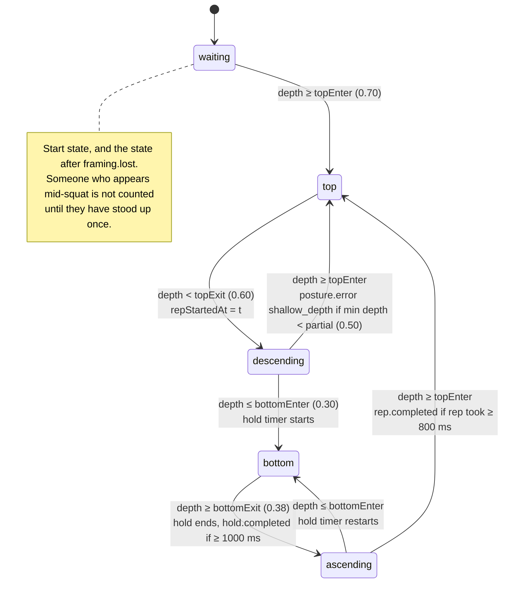
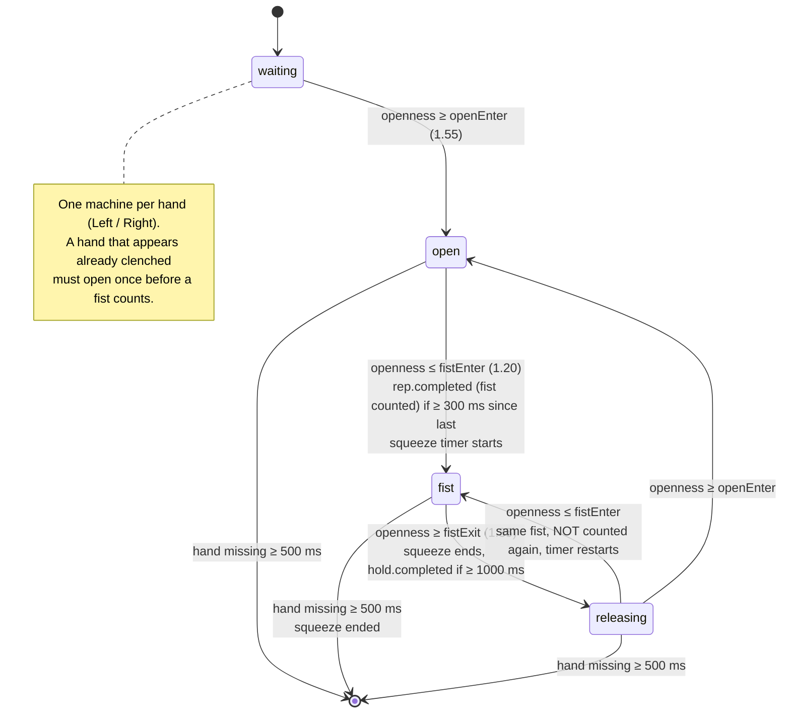
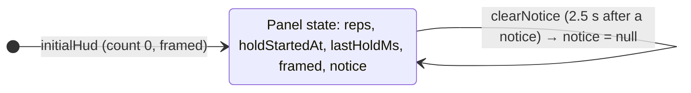

# Architecture

This document describes the application **as it is implemented today**. Everything here is traced to files in `src/`. Planned work is listed separately in [Implemented vs planned](#implemented-vs-planned). Open questions are in [Notes and unclear points](#notes-and-unclear-points).

- **Stack:** React 19, TypeScript 6, Vite 8 (HTTPS dev server through `@vitejs/plugin-basic-ssl`, module workers with `worker.format: 'es'`).
- **Libraries:** `livekit-client` with `@livekit/components-react`, and `@mediapipe/tasks-vision`.
- **Browser:** Chrome only. The default engine needs `MediaStreamTrackProcessor`.
- **Backend:** none. The only things outside the browser are LiveKit Cloud and the static model files that `scripts/setup-mediapipe.mjs` downloads into `public/mediapipe/models/`.

## Contents

1. [Source layout](#source-layout)
2. [System architecture](#1-system-architecture)
3. [LiveKit participant communication](#2-livekit-participant-communication)
4. [MediaPipe pipeline](#3-mediapipe-pipeline)
5. [Exercise tracking](#4-exercise-tracking)
6. [Thread and message summary](#5-thread-and-message-summary)
7. [Implemented vs planned](#implemented-vs-planned)
8. [Notes and unclear points](#notes-and-unclear-points)

## Source layout

| Folder | Responsibility | Key files |
|---|---|---|
| `src/` | Entry point and top-level screen switch | `main.tsx`, `App.tsx`, `config.ts` |
| `src/livekit/` | Joining, the room, the participant grid, the exercise context | `JoinForm.tsx`, `token.ts`, `media.ts`, `RoomView.tsx`, `ParticipantGrid.tsx`, `exerciseContext.ts` |
| `src/pose/` | Detection engines, the Web Worker, the worker message protocol, the pose wire format, drawing | `usePoseDetection.ts`, `engines.ts`, `pose.worker.ts`, `protocol.ts`, `processFrame.ts`, `createLandmarker.ts`, `poseWire.ts`, `drawPose.ts`, `settings.ts` |
| `src/posture/` | Exercise registry and rules engines (worker-safe: no DOM, React or LiveKit) | `exercises.ts`, `analyzer.ts`, `squatAnalyzer.ts`, `fistAnalyzer.ts`, `types.ts`, `landmarks.ts`, `sampleAnalyzer.ts` |
| `src/components/` | Overlays and the on-screen counters | `PoseOverlay.tsx`, `RemotePoseOverlay.tsx`, `PostureHud.tsx`, `postureHudState.ts`, `ExercisePicker.tsx` |
| `src/types/` | Shared data types and the declaration for Chrome's `MediaStreamTrackProcessor` | `pose.ts`, `insertable-streams.d.ts` |

---

## 1. System architecture



**How to read it**

- **Main thread** owns the UI, LiveKit, the canvas and the counters.
- **Worker** owns MediaPipe and the exercise rules. Only plain data crosses between them. The default engine is the exception: the camera's `ReadableStream<VideoFrame>` is transferred to the worker once.
- **Remote participants** never run detection for someone else. Each participant detects on their own camera and broadcasts landmarks. Everyone else just draws them.
- **Exercise choice** comes from `ExerciseContext`, which `RoomView` provides. It affects only the local participant's `PoseOverlay`.

---

## 2. LiveKit participant communication

### What each piece does

| Concern | Implementation |
|---|---|
| Getting credentials | `JoinForm` with two modes. **Token:** server URL and token, prefilled from `.env.local` through `config.ts`; decoded with `describeToken`, signature not verified, expired tokens refused. **Sandbox:** `fetchSandboxToken` → `TokenSource.sandboxTokenServer`; only shown when `VITE_LIVEKIT_SANDBOX_ID` is set. |
| Connecting | `<LiveKitRoom serverUrl token connect>` in `RoomView.tsx`. |
| Publishing local audio and video | `audio` / `video` props on `LiveKitRoom`, set to `canUseMediaDevices()`. Without a secure context (HTTPS or localhost) both are `false` and the user joins view-only. The app never calls `publishTrack` itself. |
| Receiving remote tracks | `useTracks([{ source: Camera, withPlaceholder: true }], { onlySubscribed: false })` builds the tile list. `ParticipantTile` renders the video, and `RoomAudioRenderer` plays all remote audio. |
| Room and connection state | `useConnectionState` → `ConnectionBadge`. `ConnectionStateToast` shows reconnecting messages. `ControlBar` has mic/camera toggles and Leave. |
| Disconnects and errors | `onDisconnected` → `describeDisconnect(reason)` → back to `JoinForm` with a message. `onError`: a `ConnectionError` with reason `Cancelled` is ignored; other connection errors end the session; anything else shows a banner. `onMediaDeviceFailure` → `describeDeviceFailure` shows a banner. |
| Pose sharing | Sender: `PoseOverlay` → `localParticipant.publishData(encodePose(...), { reliable: false, topic: 'pose' })`, at most 15 Hz. Receiver: `RemotePoseOverlay` listens to `RoomEvent.DataReceived`, filters by topic and identity, and drops out-of-order packets with `isNewerSeq`. |

### Pose packet format (`poseWire.ts`, version 2)

| Bytes | Field |
|---|---|
| 0 | version (`2`) |
| 1 | landmark count (`0` = no person) |
| 2–3 | video width (uint16) |
| 4–5 | video height (uint16) |
| 6–9 | sequence number (uint32, module-level counter, wraps) |
| 10–17 | `sentAt` (float64, sender's `Date.now()`; logging only, not used for ordering) |
| 18 onward | 33 × (x, y, visibility) as float32 = 396 B |

Total: **414 bytes**, little-endian. Hand landmarks are **not** included.

### Sequence: two participants



---

## 3. MediaPipe pipeline

### Engines

`readPoseSettings()` in `settings.ts` picks the engine from the URL: `?pose=worker|worker-bitmap|main`, `?delegate=GPU|CPU`, `?analyzer=default|sample|off`. The defaults are `worker`, `GPU` and `default`.

| Engine | Frame access | Where MediaPipe runs | Backpressure |
|---|---|---|---|
| `worker` (default) | `track.clone()` → `MediaStreamTrackProcessor({ maxBufferSize: 1 })`. Its `ReadableStream<VideoFrame>` is **transferred** to the worker once, after `ready`. | Web Worker | The worker awaits `reader.read()` one frame at a time; the processor drops stale frames. `frame.close()` is called in a `finally` block. |
| `worker-bitmap` | Hidden `<video>` + `requestAnimationFrame` loop that skips repeated frames → `createImageBitmap` → **transferred** per frame. | Web Worker | `inFlight` flag: at most one frame at the worker; extra frames are dropped. |
| `main` | Same hidden `<video>` + `requestAnimationFrame` loop. | Main thread (baseline for comparison) | Synchronous: the UI is blocked during detection. |

All three engines use the same `createFrameProcessor`, so detection and analysis behave the same everywhere. LiveKit's own track is never stopped: the stream engine stops only its clone, and the video engines only detach `srcObject`.

### Data flow (default `worker` engine)



### Lifecycle and switching exercise

- **Start:** `PoseTile` mounts `PoseOverlay` only for the **local** participant, with a live, unmuted camera.
- **Switch:** `PoseOverlay` uses `key={exercise}`, so changing the exercise unmounts it and mounts a new one. The effect cleanup in `usePoseDetection` calls `worker.terminate()` and `clone.stop()`. A new worker then starts with the new exercise, the right models and a new analyzer. The counters restart at 0.
- **Models:** the pose model is always loaded. The hand model is loaded only when `needsHands` is true (Fist clench) and `?analyzer=default`.
- **Errors:** worker `error` messages and `worker.onerror` go to `onError`. The badge then shows `Pose error: …`.

### Worker message protocol (`protocol.ts`)

| Direction | `type` | Payload |
|---|---|---|
| main → worker | `init` | `delegate`, `modelPath`, `handModelPath`, `analyzer`, `exercise` |
| main → worker | `stream` | `readable: ReadableStream<VideoFrame>` (transferred) |
| main → worker | `frame` | `bitmap: ImageBitmap` (transferred; `worker-bitmap` engine only) |
| worker → main | `ready` | `delegate` that actually loaded |
| worker → main | `result` | `frame`, `hands`, `events`, `inferenceMs`, `analysisMs` |
| worker → main | `error` | `message` |

---

## 4. Exercise tracking

### Exercise registry and the analyzer contract



- **Input:** `analyze(input: PostureInput)` is called once per pose result, synchronously, **inside the worker**. `PostureInput` = `PoseFrame` (`width`, `height`, `landmarks` or `null`) + `timestamp` (ms, strictly increasing, the detection thread's `performance.now()`) + `hands` (`Hand2D[]`, or `null` when the hand model isn't loaded).
- **Output:** event names and shapes follow the WP-04 `bb.metrics` vocabulary, without the envelope (`types.ts`).

| Event | Data | Emitted by |
|---|---|---|
| `rep.completed` | `set`, `rep`, `tempoMs?`, `romDeg?`, `errors` | squat (rep), fist (fist made) |
| `hold.completed` | `set`, `holdMs`, `targetMs` | both, when the hold was at least `minHoldMs` (1000 ms) |
| `posture.error` | `code`, `severity`, `rep?` | squat only (`shallow_depth`) |
| `activity.progress` | `reps`, `holdMs` (current hold, 0 if none) | both, every 1 s and immediately when a hold starts or ends |
| `framing.lost` / `framing.restored` | none | both, with hysteresis (500 ms to lose, 300 ms to restore) |

### Squats (`squatAnalyzer.ts`)

**Signal:**

```
depth = (knee.y − hip.y) / |shoulder − hip|   (in pixels, per side)
```

- Each side counts only if shoulder, hip and knee all have visibility ≥ 0.5.
- The two sides are blended, weighted by visibility.
- The result is smoothed with an exponential moving average (weight 0.35).
- Standing is about 0.8–1.0. A parallel squat is about 0.0–0.2.

| Threshold (`SQUAT_RULES`) | Value | Meaning |
|---|---|---|
| `topEnter` | 0.70 | at or above: standing |
| `topExit` | 0.60 | below: descent started |
| `partial` | 0.50 | dipped below this without reaching bottom → `shallow_depth` |
| `bottomEnter` | 0.30 | at or below: in the squat position |
| `bottomExit` | 0.38 | above: leaving the squat position |
| `minRepMs` | 800 | shorter reps are ignored as noise |
| `minHoldMs` | 1000 | shorter holds don't emit `hold.completed` |



**Framing (squat):**
- A frame is "unusable" when neither side meets the visibility rule.
- After 500 ms of unusable frames: `framing.lost` is emitted, and the rep in progress and any hold are thrown away (back to `waiting`).
- After 300 ms of usable frames: `framing.restored`.
- While framing is lost, the state machine doesn't advance.

### Fist clench (`fistAnalyzer.ts`)

**Signal (per hand):**

```
openness = mean over index, middle, ring, pinky of |tip − wrist| / |knuckle − wrist|   (pixels)
```

- The thumb is ignored.
- A hand is ignored if wrist to middle knuckle is under 20 px (too far away to judge).
- The value is smoothed with an exponential moving average (weight 0.5).
- An open hand is about 1.7–2.0. A fist is about 0.8–1.1.
- Hands are told apart by MediaPipe's `handedness` (`Left` / `Right`). Each hand has its own state machine, and the fist count is the total of both.

| Threshold (`FIST_RULES`) | Value | Meaning |
|---|---|---|
| `openEnter` | 1.55 | at or above: hand open (arms the next fist) |
| `fistExit` | 1.35 | above: fist being released |
| `fistEnter` | 1.20 | at or below: hand is a fist |
| `minFistIntervalMs` | 300 | two fists from the same hand closer than this count once |
| `minHoldMs` | 1000 | shorter squeezes don't emit `hold.completed` |
| `handLostAfterMs` | 500 | a hand missing this long is reset |



**Framing (fist):**
- No hand visible for 500 ms: `framing.lost`. Any hand visible for 300 ms: `framing.restored`.
- Losing framing doesn't reset anything by itself. Each missing hand is reset by the `handLostAfterMs` rule.
- **Reported hold:** `activity.progress.holdMs` is the longest squeeze currently in progress across both hands.

### From events to the on-screen panel (`postureHudState.ts`)



- **Count:** shown under `EXERCISES[exercise].hud.countLabel` ("Squats" / "Fists").
- **Live timer:** while `holdStartedAt` is set, `LiveHold` re-renders every 100 ms. Otherwise the panel shows the last completed hold, or `–`.
- **Framing hint:** shown while `framed` is false ("Step back: shoulders, hips and knees must be visible" / "Show your hand to the camera").
- **Display only:** the panel never looks at landmarks. Everything comes from events.

---

## 5. Thread and message summary

| From → To | Mechanism | What | Rate |
|---|---|---|---|
| UI → React state | `setExercise` via `ExerciseContext` | selected exercise | on click |
| Main → Worker | `postMessage` | `init` | once per worker |
| Main → Worker | `postMessage` with transfer | `ReadableStream<VideoFrame>` (default) or `ImageBitmap` per frame (`worker-bitmap`) | once / per frame |
| Camera → Worker | transferred stream | `VideoFrame`s | camera rate (frames dropped while busy) |
| Worker → Main | `postMessage` | `ready`, `result`, `error` | `result` once per processed frame |
| Main → React state | `setStats` | stats summary | every 500 ms |
| Main → React state | `dispatchHud` | posture events | only when events exist |
| Main → LiveKit | `publishData` (lossy, topic `pose`) | 414 B pose packet | at most 15 Hz |
| LiveKit → remote main thread | `RoomEvent.DataReceived` | the same packet | as received |
| Main ↔ LiveKit | WebRTC via `LiveKitRoom` | microphone and camera tracks | continuous |

---

## Implemented vs planned

| Area | Status | Detail |
|---|---|---|
| Joining a LiveKit Cloud room (token or sandbox) | ✅ Implemented | `JoinForm`, `token.ts` |
| Publishing and receiving audio/video, room state, error handling | ✅ Implemented | `RoomView`, `ParticipantGrid` |
| View-only join without a secure context | ✅ Implemented | `media.ts`, `RoomView` |
| Pose detection in a Web Worker (3 engines, GPU with CPU fallback) | ✅ Implemented | `engines.ts`, `pose.worker.ts` |
| Hand detection (only for exercises that need it) | ✅ Implemented | `createHandLandmarker`, `needsHandModel` |
| Pose broadcast to other participants (sequence numbers, staleness) | ✅ Implemented | `poseWire.ts`, `RemotePoseOverlay` |
| Squat rep counting and hold time | ✅ Implemented | `squatAnalyzer.ts` |
| Fist counting and squeeze time | ✅ Implemented | `fistAnalyzer.ts` |
| Exercise picker and switching | ✅ Implemented | `ExercisePicker`, `exerciseContext.ts`, `key={exercise}` |
| On-screen count, hold timer, framing hint | ✅ Implemented | `PostureHud`, `postureHudState.ts` |
| Squat depth hint (`shallow_depth` → "Go a little lower") | ✅ Implemented, basic | One rule-based hint. This is **not** posture correction. |
| **Posture correction / correction suggestions** | ⏳ Planned | Not implemented. To come from externally provided posture-analysis logic (see `CLAUDE.md`). |
| Tuning `SQUAT_RULES` / `FIST_RULES` with real recordings | ⏳ Planned | The thresholds are starting values. |
| Panel extras: severity colours, set numbers, toggles | ⏳ Planned | Phase 6 in `PLAN.md`. Every event currently uses `set: 1`. |
| Sending posture events to other participants or a backend (WP-04 envelope) | ⏳ Planned / optional | Events are local only. The envelope (`v`, `id`, `seq`, `deviceTs`, …) isn't added. |
| Broadcasting hand landmarks | ❌ Not implemented | Other participants see only the body skeleton. |
| Skipping the pose model during hand-only exercises | ⏳ Optional idea | Listed in `PLAN.md`. |
| Browsers other than Chrome | ❌ Out of scope for now | The default engine needs `MediaStreamTrackProcessor`. |

---

## Notes and unclear points

1. **`src/posture/placeholderAnalyzer.ts` is unused.** Nothing imports it. It looks left over from before the squat rules existed.
2. **`sampleAnalyzer.ts` is test scaffolding.** It emits fake events on timers (`?analyzer=sample`) and isn't derived from the body.
3. **Subscribing to remote tracks relies on LiveKit defaults.** The code never sets `autoSubscribe` or subscribes manually. The diagrams show the default auto-subscribe behaviour.
4. **Track publishing is done by `LiveKitRoom`'s `audio`/`video` props.** The repo has no explicit `publishTrack` call. Publish options (resolution, simulcast, codecs) are LiveKit defaults.
5. **There's no token server in this repo.** Tokens come from `lk token create` (pasted or in `.env.local`) or from LiveKit Cloud's sandbox token server, which is for development only.
6. **The exercise choice and posture events are per participant and local.** Other participants don't know which exercise you picked or what your count is.
7. **Remote pose ordering** uses `seq`, not `sentAt`, because device clocks differ. If a sender is silent for more than 1 s, the receiver accepts the next packet whatever its `seq`. This covers a sender who reloaded the page and restarted the counter at 0.
8. **Coordinates are not mirrored.** The local tile is displayed mirrored by LiveKit's CSS, but the landmark data is not. `Left`/`Right` therefore mean the person's own left and right.
9. **Differences from the WP-04 document** (already recorded in `PLAN.md`):
   - topic `pose` here vs `bb.pose` there;
   - float32 (414 B) here vs int16 (about 200 B) there;
   - camera-rate full-resolution detection here vs 15 fps / 256 px there.

   These are deliberate for now and haven't been changed.
10. **Timings** quoted elsewhere (about 20 ms per frame for squats, about 31 ms for fist on worker/GPU) were measured with a synthetic camera in Chrome. They depend on the machine and aren't part of the architecture.

See also [`posture-integration.md`](./posture-integration.md) for how to plug in or change analyzer logic.
